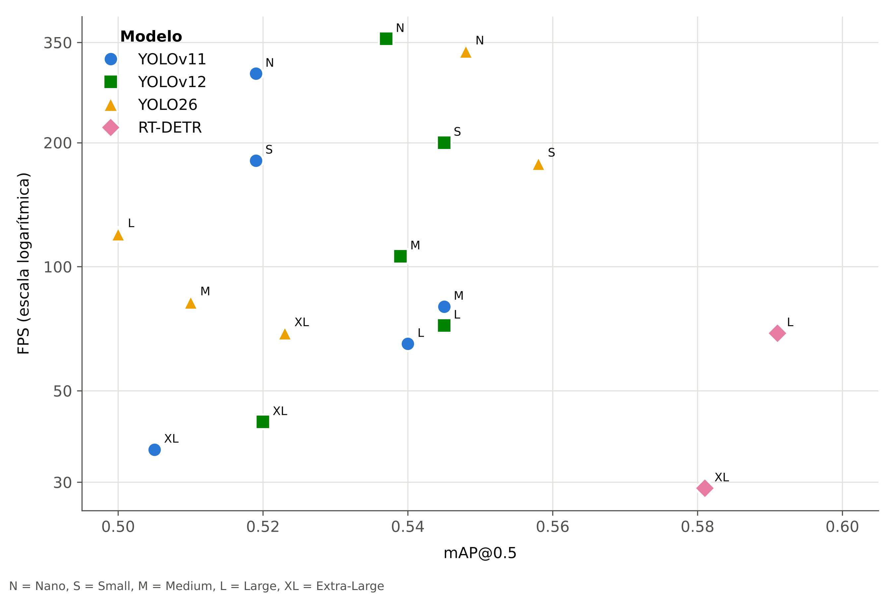
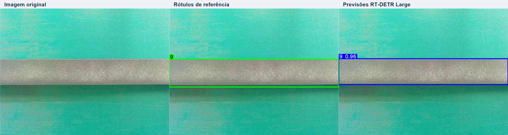
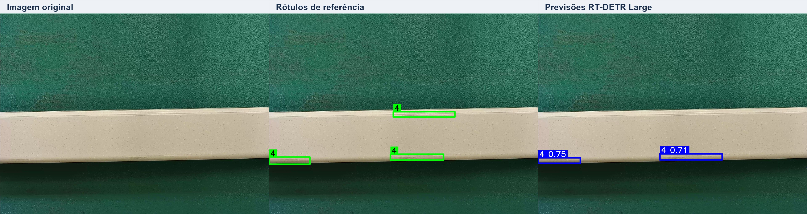
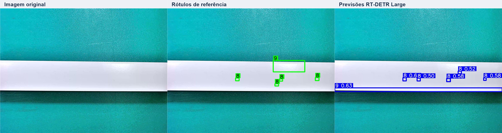

# Análise Comparativa de Modelos de Deep Learning para Detecção de Defeitos em Superfícies de Alumínio na Indústria 5.0

Repositório do trabalho **Análise Comparativa de Modelos de Deep Learning para Detecção de Defeitos em Superfícies de Alumínio na Indústria 5.0**. O projeto prepara o benchmark APDDD para detecção de objetos, treina variantes recentes de YOLO e RT-DETR e compara qualidade de detecção e velocidade de inferência.

O estudo avaliou dez classes de defeitos. O melhor resultado geral foi obtido pelo **RT-DETR Large**, com mAP@0,5 de **0,591**, F1 macro de **0,590** e **69 FPS** no hardware dos experimentos. Os pesos `best.pt` das 17 execuções estão incluídos neste repositório.


## Navegação

- [Dataset e downloads](#dataset-e-downloads)
- [Resultados](#resultados)
- [Exemplos de inferência](#exemplos-de-inferência)
- [Conteúdo do repositório](#conteúdo-do-repositório)
- [Requisitos](#requisitos)
- [Como executar](#como-executar)
- [Referência](#referência)


## Dataset e downloads

O benchmark utilizado é o **Aluminum Profile Surface Detection Database (APDDD)**. O conjunto preparado para os experimentos contém **2.903 imagens** — 1.885 imagens com defeitos e 1.018 imagens sem defeitos — e **3.143 anotações** distribuídas em dez classes. A distribuição é desbalanceada: não condutivo reúne 921 anotações e mancha de sujeira, 638, enquanto amassado tem 58. A divisão dos dados é estratificada na proporção 70:15:15 para treino, validação e teste.

Os pesos finais de melhor desempenho (`best.pt`) podem ser obtidos diretamente neste repositório, em `runs/detect/`. O dataset final utilizado nos experimentos e os dados completos das execuções (como gráficos e arquivos CSV com métricas por época) permanecem disponíveis para download nesta pasta do Google Drive:

[Baixar dataset e dados completos das execuções](https://drive.google.com/drive/u/0/folders/16O2msu5wes2TfsdnSNTJtCn7uho3aTpk)


## Resultados

O gráfico compara mAP@0,5 e FPS das variantes testadas. O eixo vertical de FPS está em escala logarítmica. Cada marcador representa uma variante de tamanho Nano (N), Small (S), Medium (M), Large (L) ou Extra-Large (XL).

<p align="center">
  
</p>

| Modelo | F1 macro | mAP@0,5 | FPS | Destaque |
| --- | ---: | ---: | ---: | --- |
| **RT-DETR Large** | **0,590** | **0,591** | 69 | Melhor qualidade geral e menor taxa de falsos negativos entre os modelos destacados. |
| YOLO26 Small | 0,437 | 0,558 | 178 | Alternativa compacta com boa precisão e maior velocidade. |
| YOLO26 Nano | 0,494 | 0,548 | 333 | Apenas 2,3 milhões de parâmetros; opção para inferência rápida e hardware embarcado. |
| YOLOv12 Nano | 0,493 | 0,537 | 357 | Maior FPS entre os modelos avaliados. |


## Exemplos de inferência

As comparações abaixo mostram a imagem original, as anotações de referência do conjunto de teste e as previsões do RT-DETR Large. Os casos ilustram tanto acertos quanto limites observados na análise qualitativa.

### Acerto em defeito sutil — APSPC1 img734

O modelo detectou o defeito não condutivo (classe 9) com confiança 0,96. A região é uma faixa estreita e alongada, com baixo contraste em relação à superfície ao redor.

<p align="center">
  
</p>

### Falso negativo entre defeitos da mesma classe — APSPC2 img1562

As anotações contêm três bolhas (classe 4). O modelo encontrou duas, com confianças 0,75 e 0,71, e deixou de detectar a instância na face superior do perfil. O exemplo evidencia como posição do defeito e condições de captura, como iluminação, podem influenciar a previsão.

<p align="center">
  
</p>

### Múltiplas classes e localização imprecisa — APSPC2 img3448

O exemplo reúne mancha de sujeira (classe 8) e não condutivo (classe 9). As classes presentes foram previstas, mas o modelo gerou seis caixas para cinco anotações e teve dificuldade em ajustar algumas localizações, sobretudo nas instâncias pequenas.

<p align="center">
  
</p>

Em uma aplicação industrial, esses resultados podem apoiar uma triagem com participação humana: o sistema sinaliza peças para avaliação, enquanto um especialista confirma casos ambíguos e corrige previsões. Isso é especialmente relevante quando um falso negativo pode deixar uma peça defeituosa seguir na linha.


## Conteúdo do repositório

| Arquivo | Finalidade |
| --- | --- |
| **create_dataset.ipynb** | Reúne imagens, rótulos e amostras sem defeito; divide os dados e gera o YAML de configuração. |
| **YOLO11.ipynb** | Treina variantes Nano, Small, Medium, Large e Extra Large da YOLOv11. |
| **YOLO12.ipynb** | Treina as cinco variantes da YOLOv12. |
| **YOLO26.ipynb** | Treina as cinco variantes da YOLO26. |
| **RT-DETR.ipynb** | Treina as variantes Large e Extra Large do RT-DETR. |
| **validations.ipynb** | Carrega os pesos treinados e executa validações e comparações. |

### Dados e diretórios esperados

~~~text
workspace/
└── TCC2/
    ├── create_dataset.ipynb
    ├── YOLO11.ipynb
    ├── YOLO12.ipynb
    ├── YOLO26.ipynb
    ├── RT-DETR.ipynb
    ├── validations.ipynb
    ├── runs/detect/                     # best.pt incluídos; registros completos no Drive
    └── dataset_APDDD_completo/            # dataset baixado
~~~

O notebook create_dataset.ipynb foi incluído no repositório para registro de como a divisão dos dados foi feita, entretanto não é possível executá-lo novamente sem as pastas originais APSPC1 e APSPC2, os quais podem ser baixados pelas referências oficiais citadas no trabalho.


## Requisitos

Requisitos: Python, Jupyter Notebook/JupyterLab, PyTorch e Ultralytics. As versões usadas nos experimentos estão em `requirements.txt`; PyTorch e torchvision foram configurados para CUDA 11.8. Verifique a compatibilidade do ambiente antes de instalar.

```bash
python -m pip install -r requirements.txt
```

Em ambientes sem GPU, pode ser necessário ajustar ou remover a configuração de dispositivos CUDA presente nos notebooks.


## Como executar

1. Baixe o dataset e, se necessário, os dados completos das execuções pela seção Downloads e extraia-os. Os `best.pt` já estão em `runs/detect/` no repositório.
2. Preserve o caminho já configurado nos notebooks
3. Abra e execute os notebooks de treinamento dos modelos que deseja avaliar: **YOLO11.ipynb**, **YOLO12.ipynb**, **YOLO26.ipynb** e/ou **RT-DETR.ipynb**. Cada notebook baixa/carrega os pesos iniciais do modelo por meio do Ultralytics e salva os resultados em runs/detect/, sob os nomes configurados nas chamadas de treinamento.
4. Abra **validations.ipynb** para validar e comparar os pesos.
5. Registre versões das bibliotecas, hardware, alterações nos parâmetros e sementes ao reproduzir ou comparar resultados.


## Citação

Se utilizar este código em pesquisa ou em trabalho acadêmico, cite o Trabalho de Conclusão de Curso correspondente e indique a versão do repositório utilizada. Consulte o texto acadêmico para os dados bibliográficos completos e as referências do conjunto APDDD.
